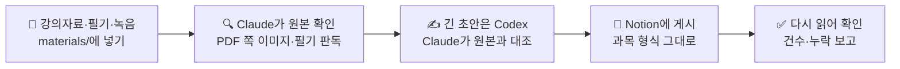

# notion-study-agent

강의자료·필기·녹음을 넣으면 Claude Code와 Codex가 서로 검토하면서 Notion 학습 노트로 정리해 주는 에이전트 규칙·스킬 모음입니다.


## 소개

대학생 한 명이 학기 중에 실제로 쓰는 작업 저장소를 공개용으로 정리한 것입니다. 앱이 아니라 **에이전트가 읽는 Markdown 규칙과 스킬**이 중심이라 코딩을 몰라도 쓸 수 있습니다.

> 파일 안의 과목명, 교재, 말투, 모델 이름은 만든 사람 상황에 맞춰진 **예시**입니다. 그대로 쓰지 말고 [SETUP.md](SETUP.md)에 내 상황을 적어 맞춘 뒤 쓰세요. 방법은 [시작하기](#시작하기)에 있습니다.

## 어떻게 동작하나



1. 과목마다 Notion에 둔 `AI 활용 문서`를 먼저 읽습니다. 이 문서가 그 과목의 페이지 구조와 말투를 정합니다.
2. PDF는 글자만 뽑지 않고 쪽 이미지를 직접 봅니다. 표·도식·손필기는 필요한 부분만 잘라 설명 바로 아래에 넣습니다.
3. 큰 변경(10건 이상, 여러 DB, 본문 교체)은 반대 도구가 읽기 전용으로 먼저 검토해 `PASS` / `BLOCK`을 줍니다.
4. 같은 작업을 다시 돌려도 중복 페이지가 생기지 않게 모든 쓰기에 고유 매칭 키를 둡니다.

## 이렇게 말하면

Claude Code를 이 폴더에서 열고 평소 말로 요청합니다.

| 이렇게 말하면 | 쓰이는 스킬 | 결과 |
| --- | --- | --- |
| "알고리즘 Week 3 PDF 올렸어, 정리해줘" | `ingest-learning-materials` → `publish-learning-notes` | Notion `Week 3` 페이지와 캡처 |
| "이번 주 범위 교재 문제 문제은행에 넣어줘" | `build-textbook-problem-bank` | 문제은행 DB 행(그림 있는 문제는 캡처) |
| "이 기출 풀어줘" | `answer-study-questions` | 대화 안의 풀이(Notion에 안 씀) |
| "오늘 정한 거 Notion에 정리해줘" | `capture-to-notion` | 정리 페이지 1개 |
| "문제은행 중복이나 빠진 거 점검해줘" | `audit-notion` | 점검 보고(읽기 전용) |
| "SETUP.md대로 이 저장소 맞춰줘" | `adapt-to-my-setup` | 내 상황에 맞게 고친 규칙·스킬 |

## 시작하기

1. 받기

   ```bash
   git clone https://github.com/aniseongu/notion-study-agent.git
   cd notion-study-agent
   tools/check-structure.sh
   ```

2. [Claude Code](https://code.claude.com/docs)로 이 폴더를 열고 `/mcp`에서 `notion` 연결(OAuth)을 마칩니다. 교차검토까지 쓰려면 [Codex CLI](https://developers.openai.com/codex)도 설치합니다.
3. [SETUP.md](SETUP.md)를 엽니다. 학교 LMS, 자료 폴더, 수강 과목, Notion 페이지, 말투를 표에 적습니다. 모르는 칸은 비워 둬도 됩니다.
4. Claude Code에 이렇게 말합니다.

   ```text
   SETUP.md를 읽고 adapt-to-my-setup 스킬로 이 저장소를 내 상황에 맞게 고쳐줘.
   Notion에는 아직 쓰지 말고, 바꿀 파일 목록부터 보여줘.
   ```

5. 과목마다 Notion에 `AI 활용 문서`가 있어야 합니다. 없으면 [templates/ai-usage-doc.md](templates/ai-usage-doc.md) 양식으로 먼저 만듭니다. 질문에 답하면 LLM이 채워 주는 프롬프트는 [CUSTOMIZE.md](docs/CUSTOMIZE.md#과목-ai-활용-문서-만들기)에 있습니다.
6. `map-notion-workspace 스킬로 내 학업 페이지를 읽기 전용으로 매핑해줘`라고 하면 Notion 페이지·DB ID가 [workspace-map.md](.claude/memory/workspace-map.md)에 채워집니다.
7. 강의 하나로 먼저 돌려 봅니다.

## 내 상황에 맞추기

LLM에게 맡기지 않고 직접 고치고 싶다면 [docs/CUSTOMIZE.md](docs/CUSTOMIZE.md)의 표를 보세요. 파일마다 지금 들어 있는 작성자 상황과 바꿀 내용을 적어 두었습니다. 자주 바꾸는 곳은 이렇습니다.

| 바꿀 것 | 파일 |
| --- | --- |
| 주차를 정하는 기준(학교 LMS 주차 모듈 등) | `.claude/rules/learning-materials.md` 「주차 확정」 |
| 교재 문제 종류와 번호 형식 | `.claude/skills/build-textbook-problem-bank/SKILL.md` |
| 노트 말투, 밈 사용 여부 | `.claude/rules/content-style.md`, `.claude/memory/style-profile.md` |
| Codex·Claude 모델 이름 | `AGENTS.md` 6절, `.claude/rules/tool-routing.md`, `.codex/config.toml` |

**강의 영상 다운로드는 들어 있지 않습니다.** 학교마다 사이트가 달라서입니다. [templates/lecture-download-skill.md](templates/lecture-download-skill.md)를 주고 "우리 학교 LMS용으로 만들어줘"라고 하면 LLM이 사이트를 읽고 내 학교용 스킬을 새로 만듭니다. 로그인은 내가 직접 하고, 비밀번호·쿠키는 파일에 남기지 않는 조건이 양식에 들어 있습니다. 영상이 필요 없으면 녹음·자막 파일을 `materials/inbox/`에 넣으면 됩니다.

## Notion CLI 함께 쓰기

평소 읽기·쓰기는 Notion MCP로 하고, 공식 CLI `ntn`은 스크립트로 반복하는 일에 씁니다.

- 강의 캡처·PDF를 한꺼번에 올리고 업로드 ID만 받아 본문에 넣기
- `ntn datasources query`로 매칭 키를 찾은 뒤 생성·수정하는 반복 작업
- CI에서 읽기 전용 점검

설치와 주의점은 [docs/NOTION-CLI.md](docs/NOTION-CLI.md)에 있습니다.

## 폴더 구조

```text
.
├── SETUP.md          내 상황 적기 (여기부터)
├── AGENTS.md         공용 규칙 원본. Claude Code와 Codex가 모두 읽음
├── CLAUDE.md         Claude Code 진입점, 스킬 목록
├── .claude/
│   ├── skills/       상황별 절차 (폴더마다 SKILL.md)
│   ├── rules/        안전·말투·자료 처리·도구 선택 같은 세부 규칙
│   └── memory/       Notion ID, 반복 작업 계약, 결정 기록 (처음엔 빈 템플릿)
├── .codex/           Codex 설정. skills·rules·memory는 .claude를 가리키는 링크
├── templates/        계획, 검토 패킷, AI 활용 문서, 강의 다운로드 스킬 양식
├── tools/            게시 전 린터, 구조 검사, 영상→mp3, Whisper 전사
├── docs/             맞추기 안내, 구조 자세히, Notion CLI, 연결 방법
├── examples/         공통 말투 블록 예시
└── materials/        강의자료·녹음·캡처를 넣는 곳 (git에 안 올라감)
```

Windows에서 받으면 `.codex/`의 심볼릭 링크가 일반 파일로 풀릴 수 있습니다. WSL에서 받거나 `git config core.symlinks true`를 켜 주세요.

## 안전장치

- **추측하지 않습니다.** 같은 이름의 페이지가 둘이면 ID와 상위 위치로 확인하고, 그래도 모호하면 묻습니다.
- **쓰기 전에 다시 읽습니다.** 페이지 본문과 DB 스키마를 그때그때 가져와 실제 속성에 맞춰 씁니다. 지시받지 않은 속성·블록은 건드리지 않습니다.
- **스키마 변경, 이동, 삭제, 공유 변경은 명시적으로 승인할 때만** 합니다. 토큰·쿠키·개인정보는 저장소 파일에 남기지 않습니다.

## 더 보기

| 문서 | 내용 |
| --- | --- |
| [docs/ARCHITECTURE.md](docs/ARCHITECTURE.md) | 파일·스킬·Notion 문서가 서로 어떻게 연결되는지 그림과 표 |
| [docs/CUSTOMIZE.md](docs/CUSTOMIZE.md) | 파일별로 바꿀 곳, LLM에게 줄 프롬프트 |
| [docs/NOTION-CLI.md](docs/NOTION-CLI.md) | `ntn` 활용 |
| [docs/INTEGRATIONS.md](docs/INTEGRATIONS.md) | MCP·플러그인·Codex 연결 방법 |

## 알려진 한계

- 한국어 학습 노트 기준입니다. 다른 언어로 쓰려면 말투 규칙을 바꿔야 합니다.
- 규칙 곳곳의 `(날짜 사용자 지시)` 표시는 작성자가 그 규칙을 정한 기록입니다. 지우거나 내 기준으로 바꿔도 됩니다.
- 모델 이름(`gpt-6-sol`, `claude-opus-5-5` 등)은 2026년 10월 기준입니다. 모델 목록이 바뀌면 [tool-routing.md](.claude/rules/tool-routing.md)의 선택표를 고쳐 주세요.
- CLOVA Note 웹 자동 전사는 서비스 약관상 자동화 제한이 있을 수 있습니다. 위험을 직접 판단해 쓰고, 부담되면 로컬 Whisper(`tools/transcribe.sh`)를 쓰세요.
- 강의 영상·자료의 저작권은 학교와 교수님께 있습니다. 내가 수강하는 강의를 개인 학습용으로만 쓰고 공유하지 마세요.
- 아직 Claude Code 플러그인으로 묶지 않았습니다. 폴더를 받아 그 안에서 실행합니다. WSL2 Ubuntu에서만 확인했습니다.

## 참고한 저장소

| 프로젝트 | 참고한 부분 |
| --- | --- |
| [openai/skills — notion-knowledge-capture](https://github.com/openai/skills/blob/main/skills/.curated/notion-knowledge-capture/SKILL.md) | search → fetch → 스키마 확인 후 생성·수정 흐름 |
| [anthropics/claude-tag-plugins — notion-api](https://github.com/anthropics/claude-tag-plugins/tree/main/notion/skills/notion-api) | DB와 data source 구분, 끝까지 pagination |
| [makenotion/claude-code-notion-plugin](https://github.com/makenotion/claude-code-notion-plugin) | OAuth 원격 MCP 선언 |
| [Jellypod-Inc/school-skills](https://github.com/Jellypod-Inc/school-skills) | 강의 → 학습 가이드 구성, 코딩 모르는 사람 기준 README |
| [ItsAlwaysRaining/claude-skills — course-notes](https://github.com/ItsAlwaysRaining/claude-skills) | 처음 실행 때 내 설정을 받아 두는 방식 |
| [ImRonalddd/claude-canvas-downloader](https://github.com/ImRonalddd/claude-canvas-downloader) | 학교 사이트를 하드코딩하지 않고 LLM이 사이트를 읽게 하는 방식 |
| [centminmod/my-claude-code-setup](https://github.com/centminmod/my-claude-code-setup) | "이 파일을 읽고 내 설정을 바꿔줘" 프롬프트로 맞추는 방식 |
| [obra/superpowers](https://github.com/obra/superpowers) | 그림 대신 사용자 입장의 짧은 설명으로 동작을 보여 주는 README |
| [microsoft/markitdown](https://github.com/microsoft/markitdown) · [MCP PDF Server](https://github.com/modelcontextprotocol/ext-apps/tree/main/examples/pdf-server) | 문서 텍스트 추출, PDF 쪽 확인 |

## 라이선스

[MIT](LICENSE). 강의자료·교재·전사 같은 학습 원본은 이 저장소에 들어 있지 않습니다.
