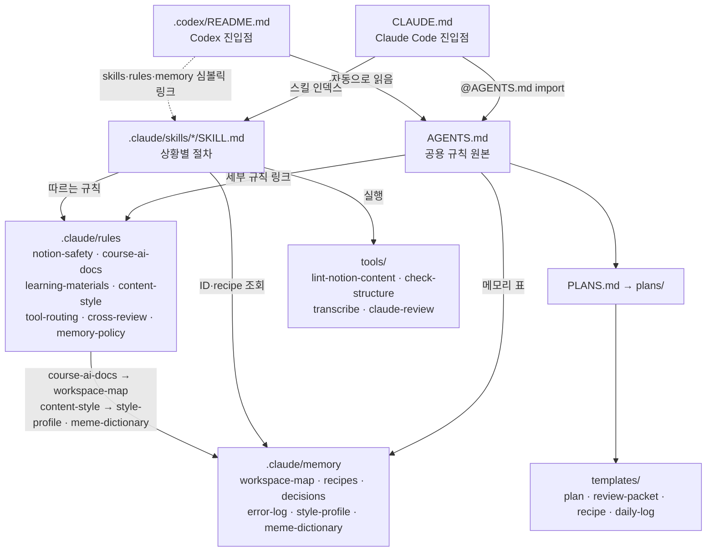
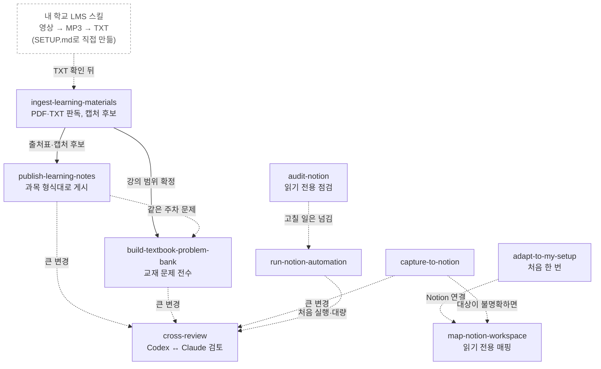
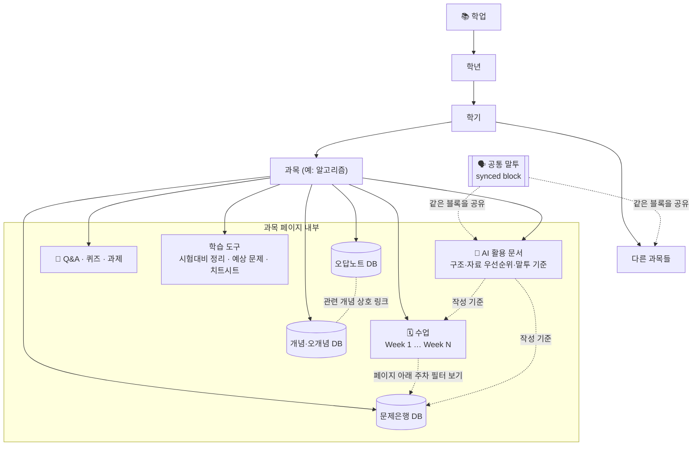
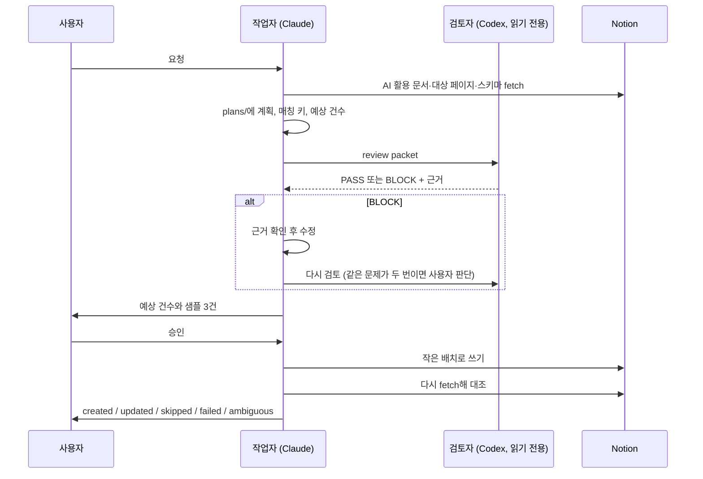

# 구조 자세히 보기

README의 흐름도보다 깊게 보고 싶을 때 읽는 문서입니다. 파일끼리 어떻게 읽히는지, 스킬끼리 어떻게 이어지는지,
Notion 쪽 문서가 어떻게 배치되는지를 그림과 표로 정리했습니다.

## 1. 규칙 파일이 읽히는 순서

진입점은 도구마다 다르지만 모두 `AGENTS.md` 하나로 모입니다. `AGENTS.md`에는 항상 지킬 규칙만 두고, 자세한 절차는
`rules/`와 스킬로 나눴습니다. 에이전트는 필요한 rule·memory만 그때 읽습니다.

| 파일 | 역할 |
| --- | --- |
| `AGENTS.md` | 절대 규칙, 작업 계약, 파이프라인, 교차검토, 완료 보고 형식. 공용 규칙은 여기만 고칩니다. |
| `CLAUDE.md` | Claude Code 진입점. 스킬 인덱스와 세션 시작 순서 |
| `.claude/rules/` | 주제별 세부 규칙 7개 |
| `.claude/memory/` | 다시 쓸 사실만 압축. 대화 전문이나 Notion 본문은 넣지 않음 |
| `.claude/skills/` | 상황별 절차. 폴더마다 `SKILL.md` |
| `templates/` | 계획, 검토 패킷, recipe, 일지, AI 활용 문서, 강의 다운로드 스킬 양식 |
| `tools/` | 린터, 구조 검사, 오디오 변환, 전사, Claude 검토 스크립트 |

## 2. 스킬끼리 이어지는 방식

강의 영상 다운로드 스킬은 학교마다 달라서 저장소에 없습니다. [templates/lecture-download-skill.md](../templates/lecture-download-skill.md)로
내 학교용을 만들면 점선 상자 자리에 들어갑니다. Notion에 쓰는 스킬은 10건 이상 수정, 여러 DB, 본문 교체처럼
**큰 변경일 때만** `cross-review`를 거칩니다.

| 스킬 | 언제 | 다음 단계 |
| --- | --- | --- |
| `adapt-to-my-setup` | 처음 받았을 때 | `map-notion-workspace` |
| 내 학교 LMS 스킬 | 강의 영상을 받아 TXT까지 | `ingest-learning-materials` |
| `ingest-learning-materials` | PDF·필기·TXT가 들어왔을 때 | `publish-learning-notes`, `build-textbook-problem-bank` |
| `publish-learning-notes` | 주차 노트를 Notion에 쓸 때 | 같은 주차 문제은행 |
| `build-textbook-problem-bank` | 강의 범위 교재 문제를 넣을 때 | 큰 변경이면 `cross-review` |
| `capture-to-notion` | 대화·결정을 한 페이지로 남길 때 | 대상이 불명확하면 `map-notion-workspace` |
| `run-notion-automation` | 확정된 반복 작업 | 처음 실행·대량이면 `cross-review` |
| `audit-notion` | 중복·누락 점검(읽기 전용) | 고칠 일은 `run-notion-automation` 등으로 |
| `answer-study-questions` | 문제 풀이만 | Notion에 쓰지 않음 |

## 3. Notion 쪽 배치

`학업 / 학년 / 학기 / 과목` 트리 아래에 과목마다 `AI 활용 문서`를 둡니다. 모든 과목 문서가 공통 말투 블록(synced block)을
공유하고, 과목별 문서가 그 과목의 페이지·DB 작성법을 정합니다. 아래는 한 과목을 펼친 예입니다. 어떤 페이지·DB를 둘지는
과목마다 다르며, 그 과목의 `AI 활용 문서`에 적습니다.

| Notion 문서 | 무엇을 담나 | 저장소에서 연결되는 곳 |
| --- | --- | --- |
| `AI 활용 문서` | 자료 우선순위, 페이지 구성, 캡처·문제은행 규칙, 말투 | `course-ai-docs.md`가 선독 절차를, `workspace-map.md`가 페이지 ID를 가짐. 양식은 `templates/ai-usage-doc.md` |
| 공통 말투 블록 | 모든 과목 노트의 한국어 말투 | `style-profile.md`가 요약 사본. 예시는 `examples/ai-usage-docs/` |
| Week N | 강의자료 순서대로 정리한 주차 노트와 캡처 | `publish-learning-notes`, `materials/index.md`의 캡처 출처 |
| 문제은행 DB | 교재 연습문제 원문·풀이 | `build-textbook-problem-bank`, 매칭 키 `data source ID + 정규화한 문제 번호` |
| 개념·오개념 / 오답노트 DB | 개념별 보완, 틀린 문항 | 과목 `AI 활용 문서`가 생성 기준을 정함 |

## 4. 큰 변경의 교차검토

Codex가 작업자일 때는 반대로 Claude가 읽기 전용으로 검토합니다. 검토자는 Notion과 MCP 도구를 모두 끈 상태에서 패킷만 읽습니다.
명령은 [cross-review.md](../.claude/rules/cross-review.md)에 있습니다.
